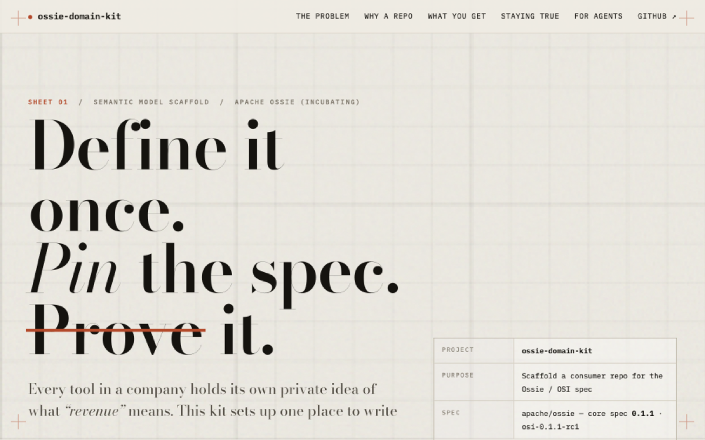

# ossie-domain-kit

**[cskwork.github.io/ossie-domain-kit](https://cskwork.github.io/ossie-domain-kit/)** —
what this is, in plain language.

[](https://cskwork.github.io/ossie-domain-kit/)

Scaffold a **domain semantic-model repository** that consumes the
[Apache Ossie (incubating)][ossie] specification — formerly OSI, Open Semantic
Interchange.

Every tool in a company holds its own private idea of what "revenue" means. This
kit creates the one place where the real definition lives, in an open format that
dashboards, spreadsheets and AI assistants can all read.

One command gives you a repo with the upstream schema and validator vendored
and pinned, a passing example model, CI, an `AGENTS.md` for coding agents, and
an authoring skill.

```bash
git clone https://github.com/cskwork/ossie-domain-kit
cd ossie-domain-kit
./bootstrap-ossie-domain.sh retail ~/git/retail-ossie
cd ~/git/retail-ossie && make validate      # PASS
```

## A worked example

[**cskwork/chinook-ossie**](https://github.com/cskwork/chinook-ossie) was generated with
this kit: the Chinook sample database modelled as 8 datasets, 7 relationships and 7
metrics — and verified against the real `CREATE TABLE` script, not just validated against
the schema. It also shows what the `verify` layer looks like once it is wired up
(`scripts/verify_ddl.py`, ~230 lines, `sqlglot`-based).

## Why not just fork apache/ossie?

Because apache/ossie is where the **specification** is developed — CLI,
converters, Python package, ASF release machinery, upstream issues. A repo that
merely *uses* Ossie to define a domain wants almost none of that, and a fork
makes it awkward to both track upstream and keep your own models.

This kit takes the four things a consumer actually needs — the schema, the
validator, the shape of a model, and the discipline around evidence — and
leaves the rest upstream.

## What gets generated

```
<domain>-ossie/
├── models/<domain>/<domain>_example_model.yaml   # passing starter, replace it
├── schema/
│   ├── osi-schema.json        # vendored from apache/ossie core-spec/
│   └── SOURCE.md              # upstream ref + commit SHA + update procedure
├── scripts/validate.py        # vendored from apache/ossie validation/
├── docs/
│   ├── overview.md            # model catalogue, conventions, decisions
│   └── verification.md        # how to prove models match real schemas
├── .claude/skills/ossie-domain-model/   # authoring skill for coding agents
├── .github/workflows/validate.yml       # make validate on push + PR
├── AGENTS.md                  # rules for coding agents
├── Makefile                   # validate / verify / check
├── README.md, LICENSE, NOTICE, .gitignore, .editorconfig
└── (git repo, initial commit on `main`)
```

Nothing is pushed anywhere — creating the remote is your call.

## Usage

```
./bootstrap-ossie-domain.sh <domain> [target-dir] [options]

  --from-clone DIR   use a local apache/ossie clone instead of downloading
  --ref REF          upstream branch/tag/SHA to pull from (default: main)
  --no-git           skip git init + initial commit
  --no-skill         do not install the authoring skill
```

The domain slug is lowercase `[a-z0-9-]`; target defaults to `./<domain>-ossie`.
Both the schema and the validator are pinned, and the resolved commit SHA is
written into `schema/SOURCE.md` and `NOTICE` so a generated repo can always say
exactly which spec revision it was built against.

Requires `bash`, `python3` (for stamping and validation), and either `curl` or
`--from-clone`. Model validation itself uses [uv](https://docs.astral.sh/uv/),
which resolves the validator's dependencies from its inline script metadata.

## The two-layer discipline

The generated `Makefile` separates two questions that are easy to conflate:

- **`make validate` — spec compliance.** Structure, enums, unique names,
  relationship references, SQL parsing. Fully generic; runs in CI from day one.
- **`make verify` — reality.** Do these tables and columns actually exist, with
  these types? This one *cannot* be generic — it depends on whether your source
  of truth is a DDL dump, `information_schema`, a dbt manifest, or an ERD. It
  ships as a loud no-op, and `docs/verification.md` walks through wiring it up.

A spec-valid model that misrepresents the warehouse is worse than no model: an
agent will confidently generate SQL against columns that do not exist. Hence
the third piece — every model carries its evidence and an honest grade of
*verified* / *inferred* / *proposed*.

## Using the skill on its own

`skills/ossie-domain-model/` is a standalone agent skill (Claude Code and
compatible harnesses). The bootstrap installs it into each generated repo; to
have it available everywhere:

```bash
ln -s "$PWD/skills/ossie-domain-model" ~/.claude/skills/ossie-domain-model
```

It covers authoring, the spec cheat sheet, evidence gathering from DDL / dbt /
ORM / SQL mappers, and a review checklist.

## Contributing

Keep `template/` domain-agnostic — anything specific to one industry or one
company belongs in the generated repo, not here. Test changes end to end:

```bash
./bootstrap-ossie-domain.sh smoke /tmp/smoke-ossie --no-git && \
  (cd /tmp/smoke-ossie && make validate)
```

## Licence

Apache License 2.0 — see [LICENSE](LICENSE) and [NOTICE](NOTICE).

This project is **not** affiliated with or endorsed by the Apache Software
Foundation. It generates repositories that vendor Apache Ossie (incubating)
files under the Apache License 2.0, recording provenance in each generated
repo's `schema/SOURCE.md` and `NOTICE`.

[ossie]: https://github.com/apache/ossie
